# Skyline Student Association — Student Organization System (SO-OS)

[](https://github.com/A-Deepak1610/OdooNmit/actions)


-FF4500?logo=mysql&logoColor=white)


> **One unified digital backbone to manage Events, Members, Merchandise, Tasks, and Treasury in one place.**  
> Built as a production-grade modular monolith for the 24-hour Odoo Hackathon.

---

## 1. Executive Summary & The Challenge

Running a student organization shouldn't be harder than passing finals. Today, the **Skyline Student Association** powers campus life through events, merchandise, and fundraisers, but operates on fragile, fragmented ad-hoc tools:

| Domain | Today's Broken Workflow | Skyline OS Production Solution |
| :--- | :--- | :--- |
| **Member Sign-ups** | Scrambled spreadsheets; dues forgotten; unverified members. | Self-service registration, digital membership ID cards, automated dues ledger, and expiration tracking. |
| **Event Ticketing** | Paper lists, cash at the door, long queues, zero fraud prevention. | Tiered member/guest pricing, real-time inventory limits, sub-second QR code ticket check-ins, and attendance reporting. |
| **Club Announcements** | Lost in fragmented WhatsApp group chats. | Centralized broadcast bulletins with notice categories, pin boards, and an auditable notification history. |
| **Merchandise Sales** | Manual orders scribbled on paper, chaotic size tracking, chasing payments. | Digital store with real-time size & inventory matrix, instant checkout, and barcode/order fulfillment workflows. |
| **Fundraiser Planning** | Unorganized group chat delegation, lost accountability, forgotten supplies. | Visual task planner & Kanban board with volunteer assignees, due dates, and budget/target trackers. |
| **Treasury & Expenses** | Physical receipts in shoe boxes, pencil-and-paper accounting, end-of-semester dread. | Double-entry inspired audit ledger, volunteer expense reimbursement workflow with receipt upload & approval, and real-time P&L balance sheets. |

---

## 2. A Semester With Skyline OS: The 6 Core Scenes

```mermaid
flowchart TD
    subgraph S1["1. Membership"]
        M1[Student Signs Up] --> M2[Dues Paid & Recorded]
        M2 --> M3[Digital Member Card & Perks]
    end

    subgraph S2["2. Events & Ticketing"]
        E1[Spring Gala Published] --> E2[Tiered Member Discounts]
        E2 --> E3[Fast QR Door Check-In]
    end

    subgraph S3["3. Broadcasts"]
        B1[Meeting Announcement] --> B2[All-Member Bulletin Board]
    end

    subgraph S4["4. Merchandise"]
        MD1[Hoodie Store Drop] --> MD2[Real-Time Size Matrix]
        MD2 --> MD3[Online Orders & Fulfillment]
    end

    subgraph S5["5. Fundraiser Tasks"]
        F1[Bake Sale Project] --> F2[Volunteer Task Board]
        F2 --> F3[Supply & Shift Tracking]
    end

    subgraph S6["6. Treasury & Ledger"]
        T1[Dues Revenue] --> T4[Central Financial Ledger]
        T2[Ticket & Merch Sales] --> T4
        T3[Volunteer Expense Claims] --> T4
        T4 --> T5[Semester-End Audit & Balance Sheet]
    end
```



### Scene 1: A New Student Joins
- **Problem:** Students register at campus fairs, but officers lose track of who has paid dues, memberships expire silently, and checking active status at events requires searching large spreadsheets.
- **Solution:** Instant onboarding with a verifiable `MemberProfile`, digital member pass with dynamic QR status, automatic renewal alerts, and membership tier validation for exclusive discounts.

### Scene 2: Selling Tickets for the Spring Gala
- **Problem:** Overcrowded venues, cash handling errors, paper ticket fraud, and tedious door check-ins with printed rosters.
- **Solution:** Online ticketing with member vs. non-member pricing rules, real-time seat inventory locks, sub-second cryptographic QR check-in scanner via mobile camera, and live dashboard analytics for turnout and revenue.

### Scene 3: Announcing the Next Meeting
- **Problem:** Critical meeting notifications and schedule changes get buried in noisy WhatsApp groups.
- **Solution:** A centralized broadcast bulletin system with tags (Urgent, General, Meeting, Social), markdown formatting, and an indelible historical record of all organizational memos.

### Scene 4: Ordering Hoodies for the Club
- **Problem:** Officers manually collect hoodie sizes on paper, leading to inventory shortages, misplaced money, and sizing disputes.
- **Solution:** Dedicated campus store with a matrix of product variants (sizes `S` to `XXL`, colors), real-time stock deductions, order status lifecycles (`PENDING` → `CONFIRMED` → `READY_FOR_PICKUP` → `FULFILLED`), and member-exclusive pricing.

### Scene 5: Planning a Fundraiser (Bake Sale)
- **Problem:** Volunteer teams duplicate work or let critical errands fall through the cracks because coordination only happens across disjointed chat threads.
- **Solution:** Lightweight project coordination board where organizers create task cards (`Bake Brownies`, `Buy Napkins`, `Table Shift 1`), assign volunteers, attach budgets, and monitor progress until the target is met.

### Scene 6: The Treasurer at the End of the Semester
- **Problem:** The treasurer spends finals week sorting crumpled paper receipts and matching bank deposits with notebooks.
- **Solution:** Automated financial aggregation engine. Every dues transaction, ticket sale, and hoodie purchase automatically credits the ledger. Volunteers submit digital expense claims with attached receipt images; once approved by the treasurer, reimbursement is recorded and the semester financial balance sheet generates automatically.

---

## 3. High-Level System Architecture

Skyline OS is built as a strict **Modular Monolith** designed for high throughput, low latency, and zero microservice overhead:

```
┌─────────────────────────────────────────────────────────────────────────┐
│                      Client Layer (React 18 + Vite)                     │
│  Tailwind CSS Design Tokens • Zustand State Stores • Lucide React Icons │
│  Shared Responsive AppLayout • AppSidebar (Role-Filtered) • AppHeader   │
└────────────────────────────────────┬────────────────────────────────────┘
                                     │ JSON REST API / Axios
                                     ▼
┌─────────────────────────────────────────────────────────────────────────┐
│                 Backend Modular Monolith (Node.js ESM)                  │
│  Express.js API Gateway • Request ID UUID Middleware • CORS & Security  │
│  Central AppError Handler • Role-Based Access Control (RBAC) Guard     │
├─────────────────┬─────────────────┬──────────────────┬──────────────────┤
│ Members Module  │ Events & Tickets│ Store & Merch    │ Treasury Ledger  │
│ Announcements   │ Volunteer Tasks │ Expense Claims   │ Health & Metrics │
└─────────────────┴────────┬────────┴──────────────────┴──────────────────┘
                           │ Parameterized MySQL Queries
                           ▼
┌─────────────────────────────────────────────────────────────────────────┐
│              Prisma ORM 5.x  ──►  TiDB Cloud Serverless                │
│       Relational Schema • ACID Transactions • TLS Encrypted (MySQL)     │
└─────────────────────────────────────────────────────────────────────────┘
```

---

## 4. Role-Based Access Control (RBAC) Matrix

| User Role | Members & Dues | Events & Tickets | Check-In Scanner | Store & Merch | Tasks & Projects | Expense Claims | Treasury Ledger |
| :--- | :---: | :---: | :---: | :---: | :---: | :---: | :---: |
| **`ADMIN` (President)** | Full Access | Full Access | Yes | Full Access | Full Access | Approve/View | View Reports |
| **`TREASURER`** | View & Verify | View Revenue | Yes | Manage Sales | Manage Budget | Review & Pay | Full Access |
| **`EVENT_LEAD`** | View Members | Create & Manage | Yes | View Merch | Create & Assign | Submit Claims | View Event P&L |
| **`VOLUNTEER`** | Search Member | View Assigned | Yes | Pickup Helper | Execute Tasks | Submit Claims | No Access |
| **`MEMBER`** | My Pass & Dues | Buy Member Tix | View Own | Buy Merch | View Public | No Access | No Access |
| **`PUBLIC / GUEST`**| Join Club | Buy Guest Tix | View Own | Browse Store | No Access | No Access | No Access |

---

## 5. Domain Data Model & Relational Schema (Prisma + TiDB)

The system leverages TiDB Cloud Serverless with standard MySQL wire protocol. The relational architecture spans the 6 core problem domains:

```prisma
// Core User & Authentication
model User {
  id            String         @id @default(uuid())
  email         String         @unique
  fullName      String
  role          UserRole       @default(MEMBER)
  studentId     String?        @unique
  phone         String?
  avatarUrl     String?
  createdAt     DateTime       @default(now())
  updatedAt     DateTime       @updatedAt

  memberProfile MemberProfile?
  ticketOrders  TicketOrder[]
  merchOrders   MerchOrder[]
  assignedTasks Task[]
  expenseClaims ExpenseClaim[]

  @@map("users")
}

enum UserRole {
  ADMIN
  TREASURER
  EVENT_LEAD
  VOLUNTEER
  MEMBER
  GUEST
}

// 1. Membership & Dues
model MemberProfile {
  id              String           @id @default(uuid())
  userId          String           @unique
  user            User             @relation(fields: [userId], references: [id], onDelete: Cascade)
  membershipTier  MembershipTier   @default(STANDARD)
  duesStatus      DuesStatus       @default(PENDING)
  validUntil      DateTime
  qrPassCode      String           @unique @default(uuid())
  duesPayments    DuesPayment[]

  @@map("member_profiles")
}

enum MembershipTier {
  STANDARD
  PREMIUM
  HONORARY
}

enum DuesStatus {
  PENDING
  ACTIVE
  EXPIRED
  GRACE_PERIOD
}

model DuesPayment {
  id              String        @id @default(uuid())
  memberProfileId String
  memberProfile   MemberProfile @relation(fields: [memberProfileId], references: [id])
  amount          Decimal       @db.Decimal(10, 2)
  academicYear    String
  semester        String
  paymentMethod   String
  paidAt          DateTime      @default(now())

  @@map("dues_payments")
}

// 2. Events & Ticketing
model Event {
  id             String        @id @default(uuid())
  title          String
  description    String        @db.Text
  location       String
  startsAt       DateTime
  endsAt         DateTime
  isPublished    Boolean       @default(false)
  ticketTiers    TicketTier[]
  ticketOrders   TicketOrder[]
  createdAt      DateTime      @default(now())

  @@map("events")
}

model TicketTier {
  id             String        @id @default(uuid())
  eventId        String
  event          Event         @relation(fields: [eventId], references: [id], onDelete: Cascade)
  name           String
  memberPrice    Decimal       @db.Decimal(10, 2)
  guestPrice     Decimal       @db.Decimal(10, 2)
  capacity       Int
  soldCount      Int           @default(0)
  tickets        TicketItem[]

  @@map("ticket_tiers")
}

model TicketOrder {
  id             String        @id @default(uuid())
  eventId        String
  event          Event         @relation(fields: [eventId], references: [id])
  buyerId        String
  buyer          User          @relation(fields: [buyerId], references: [id])
  totalAmount    Decimal       @db.Decimal(10, 2)
  paymentStatus  String        @default("PAID")
  tickets        TicketItem[]
  createdAt      DateTime      @default(now())

  @@map("ticket_orders")
}

model TicketItem {
  id             String        @id @default(uuid())
  orderId        String
  order          TicketOrder   @relation(fields: [orderId], references: [id])
  tierId         String
  tier           TicketTier    @relation(fields: [tierId], references: [id])
  qrCode         String        @unique @default(uuid())
  attendeeName   String
  isCheckedIn    Boolean       @default(false)
  checkedInAt    DateTime?

  @@map("ticket_items")
}

// 3. Announcements
model Announcement {
  id             String        @id @default(uuid())
  title          String
  content        String        @db.Text
  category       String        @default("General") // Meeting, Urgent, Gala, Social
  isPinned       Boolean       @default(false)
  authorName     String
  createdAt      DateTime      @default(now())

  @@map("announcements")
}

// 4. Merchandise Store
model Product {
  id             String           @id @default(uuid())
  name           String
  description    String           @db.Text
  imageUrl       String?
  memberPrice    Decimal          @db.Decimal(10, 2)
  regularPrice   Decimal          @db.Decimal(10, 2)
  variants       ProductVariant[]
  isActive       Boolean          @default(true)

  @@map("products")
}

model ProductVariant {
  id             String        @id @default(uuid())
  productId      String
  product        Product       @relation(fields: [productId], references: [id], onDelete: Cascade)
  size           String        // S, M, L, XL, XXL
  color          String?
  stockQuantity  Int           @default(0)
  orderItems     OrderItem[]

  @@map("product_variants")
}

model MerchOrder {
  id             String        @id @default(uuid())
  userId         String
  user           User          @relation(fields: [userId], references: [id])
  totalAmount    Decimal       @db.Decimal(10, 2)
  status         String        @default("PENDING") // PENDING, CONFIRMED, READY, FULFILLED
  items          OrderItem[]
  createdAt      DateTime      @default(now())

  @@map("merch_orders")
}

model OrderItem {
  id             String         @id @default(uuid())
  orderId        String
  order          MerchOrder     @relation(fields: [orderId], references: [id], onDelete: Cascade)
  variantId      String
  variant        ProductVariant @relation(fields: [variantId], references: [id])
  quantity       Int
  unitPrice      Decimal        @db.Decimal(10, 2)

  @@map("order_items")
}

// 5. Fundraisers & Task Coordination
model Project {
  id             String        @id @default(uuid())
  name           String
  description    String?
  targetAmount   Decimal?      @db.Decimal(10, 2)
  raisedAmount   Decimal       @default(0) @db.Decimal(10, 2)
  tasks          Task[]
  createdAt      DateTime      @default(now())

  @@map("projects")
}

model Task {
  id             String        @id @default(uuid())
  projectId      String
  project        Project       @relation(fields: [projectId], references: [id], onDelete: Cascade)
  title          String
  description    String?
  status         TaskStatus    @default(TODO)
  assigneeId     String?
  assignee       User?         @relation(fields: [assigneeId], references: [id])
  dueDate        DateTime?

  @@map("tasks")
}

enum TaskStatus {
  TODO
  IN_PROGRESS
  DONE
}

// 6. Treasury, Expenses & Financial Ledger
model ExpenseClaim {
  id             String        @id @default(uuid())
  volunteerId    String
  volunteer      User          @relation(fields: [volunteerId], references: [id])
  title          String
  amount         Decimal       @db.Decimal(10, 2)
  category       String        // Supplies, Food, Travel, Venue
  receiptUrl     String
  status         ClaimStatus   @default(SUBMITTED)
  submittedAt    DateTime      @default(now())
  reviewedAt     DateTime?

  @@map("expense_claims")
}

enum ClaimStatus {
  SUBMITTED
  APPROVED
  REJECTED
  REIMBURSED
}

model LedgerTransaction {
  id             String          @id @default(uuid())
  type           TransactionType // REVENUE, EXPENSE
  source         String          // Dues, Spring Gala Tickets, Hoodie Sales, Bake Sale, Reimbursed Expense
  amount         Decimal         @db.Decimal(10, 2)
  referenceId    String?
  notes          String?
  recordedAt     DateTime        @default(now())

  @@map("ledger_transactions")
}

enum TransactionType {
  REVENUE
  EXPENSE
}
```

---

## 6. RESTful API Specification

Base Route: `/api/v1`

### 1. Members & Dues (`/api/v1/members`)
| Method | Endpoint | Description | Role Required |
| :--- | :--- | :--- | :--- |
| `GET` | `/members` | List members with dues filter & search | `ADMIN`, `TREASURER`, `EVENT_LEAD` |
| `POST` | `/members/register` | Register new student member profile | Public |
| `GET` | `/members/me` | Fetch logged-in user digital pass & dues | `MEMBER` |
| `POST` | `/members/:id/dues` | Record annual/semester dues payment | `TREASURER`, `ADMIN` |
| `GET` | `/members/verify-pass/:code` | Scan & verify member QR pass at door | `VOLUNTEER`+ |

### 2. Events & Ticketing (`/api/v1/events`)
| Method | Endpoint | Description | Role Required |
| :--- | :--- | :--- | :--- |
| `GET` | `/events` | List all upcoming public & member events | Public |
| `POST` | `/events` | Create new event with tiered seat allocations | `ADMIN`, `EVENT_LEAD` |
| `GET` | `/events/:id` | Event details, tier capacities, and prices | Public |
| `POST` | `/events/:id/orders` | Purchase tickets (dynamic member pricing) | Authenticated |
| `POST` | `/events/checkin` | Door scan ticket QR; validates & marks used | `VOLUNTEER`+ |
| `GET` | `/events/:id/analytics` | Real-time turnout, attendance %, and revenue | `EVENT_LEAD`, `ADMIN` |

### 3. Broadcast Announcements (`/api/v1/announcements`)
| Method | Endpoint | Description | Role Required |
| :--- | :--- | :--- | :--- |
| `GET` | `/announcements` | Fetch active bulletin notices & pinned items | Public / Member |
| `POST` | `/announcements` | Publish new broadcast announcement | `ADMIN`, `EVENT_LEAD` |
| `DELETE`| `/announcements/:id` | Remove obsolete notice | `ADMIN` |

### 4. Merchandise Store (`/api/v1/products`)
| Method | Endpoint | Description | Role Required |
| :--- | :--- | :--- | :--- |
| `GET` | `/products` | List available merchandise & variant stocks | Public |
| `POST` | `/products` | Add new apparel item with size matrix | `ADMIN`, `TREASURER` |
| `POST` | `/products/orders` | Place merch order (auto inventory decrement) | Authenticated |
| `PATCH`| `/products/orders/:id/status`| Update order fulfillment (`CONFIRMED`, `READY`) | `VOLUNTEER`+ |

### 5. Fundraisers & Task Coordination (`/api/v1/projects`)
| Method | Endpoint | Description | Role Required |
| :--- | :--- | :--- | :--- |
| `GET` | `/projects` | List active fundraisers & fundraising targets | Public / Member |
| `POST` | `/projects` | Create new campaign (e.g. Bake Sale) | `ADMIN`, `EVENT_LEAD` |
| `GET` | `/projects/:id/tasks` | Get project Kanban board tasks | `VOLUNTEER`+ |
| `POST` | `/projects/:id/tasks` | Create task card with assignee & due date | `EVENT_LEAD`+ |
| `PATCH`| `/projects/tasks/:id` | Update task status (`TODO` → `DONE`) | Assigned / `VOLUNTEER`+ |

### 6. Treasury, Expense Claims & Ledger (`/api/v1/finance`)
| Method | Endpoint | Description | Role Required |
| :--- | :--- | :--- | :--- |
| `GET` | `/finance/summary` | Semester P&L, current balance, cash flow | `TREASURER`, `ADMIN` |
| `GET` | `/finance/ledger` | Detailed chronological transaction ledger | `TREASURER`, `ADMIN` |
| `POST` | `/finance/expenses` | Submit volunteer reimbursement claim | `VOLUNTEER`+ |
| `PATCH`| `/finance/expenses/:id/approve` | Approve/Reject claim and post to ledger | `TREASURER` |

### 7. Diagnostics & Health Monitoring (`/api/v1/health`)
| Method | Endpoint | Description | DB Required? |
| :--- | :--- | :--- | :---: |
| `GET` | `/health/live` | Process liveness probe (200 OK) | No |
| `GET` | `/health/ready` | Verifies TiDB connectivity & latency | Yes |
| `GET` | `/health` | Full diagnostic overview of core subsystems | Yes |

---

## 7. Monorepo Directory Layout & Conventions

The codebase follows the strict isolated module directory conventions defined in [AGENTS.md](file:///AGENTS.md):

```
OdooNmit/
├── .github/
│   └── workflows/
│       └── ci.yaml              # GitHub Actions automated CI workflow
├── backend/
│   ├── prisma/
│   │   └── schema.prisma        # TiDB MySQL relational database schema
│   ├── src/
│   │   ├── config/              # env.js, database.js (Prisma singleton)
│   │   ├── middleware/          # request-id, not-found, error handler
│   │   ├── modules/
│   │   │   ├── health/          # Health probe module
│   │   │   ├── members/         # Member onboarding, passes, dues
│   │   │   ├── events/          # Events, ticket tiers, QR scanner
│   │   │   ├── announcements/   # Broadcast bulletin notices
│   │   │   ├── merch/           # Apparel catalogue, size variants, orders
│   │   │   ├── projects/        # Fundraiser task coordination board
│   │   │   └── finance/         # Double-entry ledger, expense claims
│   │   ├── utils/               # AppError, logger, standard helpers
│   │   ├── app.js               # Express application route mounting
│   │   └── server.js            # Node HTTP server bootstrapper
│   └── tests/
│       └── health.test.js       # Vitest + Supertest integration tests
├── frontend/
│   ├── src/
│   │   ├── app/
│   │   │   ├── App.tsx          # Root container
│   │   │   └── router.tsx       # React Router 6 configuration
│   │   ├── components/
│   │   │   ├── shared/          # Central AppHeader, AppSidebar, RouteGuard
│   │   │   └── ui/              # Tailwind Button, Card, Input, Badge
│   │   ├── config/
│   │   │   └── navigation.ts    # Centralized sidebar route & role registry
│   │   ├── layouts/
│   │   │   ├── AppLayout.tsx    # Authenticated dashboard frame
│   │   │   └── AuthLayout.tsx   # Public/login layout
│   │   ├── modules/             # Isolated feature directories:
│   │   │   ├── members/         # pages, components, services, types
│   │   │   ├── events/          # pages, components, services, types
│   │   │   ├── announcements/   # pages, components, services, types
│   │   │   ├── merch/           # pages, components, services, types
│   │   │   ├── projects/        # pages, components, services, types
│   │   │   └── finance/         # pages, components, services, types
│   │   ├── services/
│   │   │   └── api-client.ts    # Central Axios instance with interceptors
│   │   └── stores/
│   │       ├── auth.store.ts    # Zustand user & role session store
│   │       └── ui.store.ts      # Global UI toggle preferences
│   ├── tailwind.config.js       # Curated design system tokens
│   └── vite.config.ts           # Vite dev & build configuration
├── .env.example                 # Global environment variable documentation
├── package.json                 # Monorepo workspace runner scripts
└── README.md                    # System architecture & documentation
```

---

## 8. Quick Start & Local Development

### Prerequisites
- **Node.js:** `v20.x` or higher
- **npm:** `v10.x` or higher
- **Database:** Free TiDB Cloud Serverless instance (or local MySQL 8.0+)

### 1. Installation
Clone the repository and install all monorepo dependencies in a single step:
```bash
git clone https://github.com/A-Deepak1610/OdooNmit.git
cd OdooNmit
npm run install:all
```

### 2. Environment Configuration
Copy the provided environment templates:
```bash
cp .env.example backend/.env
cp .env.example frontend/.env
```

Configure your **`backend/.env`**:
```env
PORT=5000
NODE_ENV=development
APP_NAME=skyline-so-os
# Ensure TLS parameter is appended for TiDB Serverless:
DATABASE_URL="mysql://<USER>:<PASSWORD>@<HOST>:<PORT>/<DATABASE>?sslaccept=strict"
```

Configure your **`frontend/.env`**:
```env
VITE_API_URL=http://localhost:5000/api/v1
```

### 3. Database Migration
Generate Prisma Client types and synchronize schema with TiDB:
```bash
npm run prisma:generate
npm run prisma:push
```

### 4. Run Locally
Start both backend API and frontend Vite server concurrently:
```bash
npm run dev
```
- **Frontend Web Application:** [http://localhost:3000](http://localhost:3000)
- **Backend API Gateway:** [http://localhost:5000](http://localhost:5000)
- **API Health Liveness Check:** [http://localhost:5000/api/v1/health/live](http://localhost:5000/api/v1/health/live)

---

## 9. Automated CI/CD Pipeline

The project incorporates an enterprise CI/CD pipeline via GitHub Actions ([`.github/workflows/ci.yaml`](file:///.github/workflows/ci.yaml)):

```
[Push to main / Pull Request]
          │
          ├──► Job 1: Backend CI (Ubuntu, Node 20, npm ci, Prisma Generate, Vitest)
          │
          ├──► Job 2: Frontend CI (Ubuntu, Node 20, npm ci, TypeScript Check, Vite Build)
          │
          ▼
   (On Success on main)
          │
          └──► Job 3: Automated Render / Cloud Deployment Hook
```

- **Concurrency Control:** Automatically cancels obsolete redundant CI builds on rapid branch updates.
- **Dependency Caching:** Uses granular `package-lock.json` caching for fast build execution under 60 seconds.
- **Fail-Safe Verifications:** Prevents broken API routes or TypeScript compile bugs from reaching staging/production.

---

## 10. Testing & Verification

Execute tests and verify production builds before committing code:

```bash
# Execute backend test suite (Vitest + Supertest)
npm test                # Monorepo root shortcut (runs 'npm run test:backend')

# Verify frontend TypeScript compilation & production build
npm run build           # Monorepo root shortcut (runs 'npm run build:frontend')
```

---

## 11. 24-Hour Hackathon 4-Developer Coordination Plan

To eliminate merge conflicts and maximize velocity across the 4 teammates, work is isolated strictly by module boundaries:

```
┌────────────────────────────────────────────────────────────────────────┐
│                        DEVELOPER PAIRING MATRIX                        │
├─────────────────┬──────────────────────┬───────────────────────────────┤
│ Team Member     │ Primary Focus        │ Scope Boundaries              │
├─────────────────┼──────────────────────┼───────────────────────────────┤
│ Developer 1     │ Members & Dues +     │ backend/src/modules/members/  │
│ (Lead Backend)  │ Treasury Ledger      │ backend/src/modules/finance/  │
│                 │                      │ backend/prisma/schema.prisma  │
├─────────────────┼──────────────────────┼───────────────────────────────┤
│ Developer 2     │ Events & Ticketing + │ backend/src/modules/events/   │
│ (Backend / API) │ QR Door Scanner API  │ backend/src/modules/merch/    │
│                 │ Merch Store API      │ backend/src/modules/projects/ │
├─────────────────┼──────────────────────┼───────────────────────────────┤
│ Developer 3     │ Executive Dashboard, │ frontend/src/modules/members/ │
│ (Lead Frontend) │ Membership Cards,    │ frontend/src/modules/finance/ │
│                 │ & Treasury P&L UI    │ frontend/src/config/nav.ts    │
├─────────────────┼──────────────────────┼───────────────────────────────┤
│ Developer 4     │ Events Storefront,   │ frontend/src/modules/events/  │
│ (Frontend / UX) │ Fast Door Check-In,  │ frontend/src/modules/merch/   │
│                 │ Merch & Kanban Board │ frontend/src/modules/projects/│
└─────────────────┴──────────────────────┴───────────────────────────────┘
```

### Team Rules of Engagement:
1. **API Contracts First:** Before writing module code, pair backend and frontend devs to agree on URL parameters, payload bodies, and JSON responses.
2. **Never Edit Common Files In The Same Commit:** Feature code stays in `src/modules/<feature>/`. Route registration in `app.js` and `navigation.ts` happens in small, atomic commits.
3. **Re-use Existing Primitives:** Use existing Tailwind tokens (`brand-*`, `surface-*`), Lucide icons, and Axios `apiClient`. Never create parallel sidebars or separate Axios instances.
4. **Clean Git Hygiene:** Every team member works on an isolated branch (`feat/events`, `feat/members`, `feat/finance`, `feat/merch`) and merges into `main` only after CI tests pass.

---

## 12. License

Distributed under the MIT License. Built with ❤️ by the Skyline Student Association Dev Team for the Odoo Hackathon.
